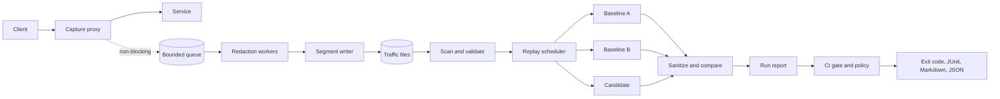

# Architecture



It runs as a local process or as a sidecar from the Helm chart. See [deployment](deployment.md).

## Capture

The client path does as little as possible. It copies bytes passing through into
budgeted memory, and after the response finishes it makes one non-blocking queue send.
A full queue drops the recording, not the request.

| Bound | Default | When exceeded |
|---|---|---|
| Request or response body | 1 MiB | Forwarded in full, body omitted from the record |
| Memory across all bodies | 256 MiB | Forwarded in full, body omitted from the record |
| Queue | 1024 exchanges | Recording dropped, `queue_full` counted |
| Decompressed body | 8 MiB | Body omitted from the record |
| Encoded record | 16 MiB | Recording dropped, `record_too_large` counted |
| Time from finished to written | 5s | Recording dropped, `deadline_exceeded` counted |

Each drop reason has its own counter. Totals are printed when capture stops and stored
in the final segment, so a replay can report the gap.

| Storage failure | Effect |
|---|---|
| Disk full | Recording dropped, `disk_full` counted, partial frame removed, retried after an interval |
| Other write error | Same, counted as `write_error` |
| Slow or stuck writes | Queue fills, then `queue_full`. Clients are unaffected. |

Capture adds some processing overhead to the request path. It was measured on one machine
in the [benchmarks](benchmarks.md).

### Shutdown

1. The HTTP server stops accepting and waits for live requests, up to a deadline.
2. Capture waits for any request it is still serving, up to a deadline. This matters
   because an HTTP/2 server can finish shutting down while the handler for a stream the
   client reset is still running.
3. Recording stops accepting, and workers drain the queue, up to a deadline.
4. The final segment is sealed with its record count and drop totals.

If a write is stuck in the OS when the deadline passes, `Close` returns and the process
exits non-zero. A goroutine blocked in that write can't be interrupted, and it exits
when the write returns.

## Protocols

HTTP/1.1, HTTP/2 and unary gRPC are supported for capture and replay. Streaming gRPC
calls are forwarded but not stored.

### Capture protocols

The two sides of the proxy are independent, so any client protocol works with any upstream
protocol. Tests cover all nine combinations of HTTP/1.1, h2c and HTTP/2 over TLS, on servers
that accept only that protocol.

| Side | Flags | Protocol |
|---|---|---|
| Client | None | HTTP/1.1 |
| Client | `--h2c` | HTTP/1.1, plus HTTP/2 without TLS |
| Client | `--tls-cert`, `--tls-key` | HTTP/1.1 or HTTP/2, negotiated with ALPN |
| Upstream | `http://` | HTTP/1.1 |
| Upstream | `http://` with `--upstream-h2c` | HTTP/2 only, with no fallback |
| Upstream | `https://` | HTTP/1.1 or HTTP/2, negotiated with ALPN |

`--upstream-ca-file` adds trusted certificates for an `https://` upstream. A record's
`protocol` is the one the client used, not the upstream hop's. **h2c is for development.** It
is unencrypted and uses prior knowledge only. The `Upgrade: h2c` handshake isn't supported.

### Replay protocols

| Target | Flags | Protocol |
|---|---|---|
| `http://` | None | HTTP/1.1 |
| `http://` | `--target-h2c` | HTTP/2 only, with no fallback |
| `https://` | None | HTTP/1.1 or HTTP/2, negotiated with ALPN |

`--target-h2c` and `--target-ca-file` apply to all targets. Reach them all the same way, or
comparisons will reflect the protocol as well as the code. Replay uses each target's
configured protocol, not the one the record was captured on, and the report counts the
protocol each response arrived on, per target, under `protocols`.

### Resends

Replay makes one attempt per target, with no retries of its own. The HTTP client can still
send a request again by itself:

| Protocol | Case | Handling |
|---|---|---|
| HTTP/1.1 | A reused connection fails, even if the target already acted | Prevented, because connections aren't reused |
| HTTP/2 | The server sends `REFUSED_STREAM` | Can't be disabled. Counted. |
| HTTP/2 | The server sends `GOAWAY` and the stream is above its last-processed ID | Can't be disabled. Counted. |

In the HTTP/2 cases, RFC 9113 means the server has said it didn't process the request, so a
resend shouldn't repeat side effects unless the server is wrong about that. Tests observed
that `PROTOCOL_ERROR`, `INTERNAL_ERROR`, a closed connection and a `GOAWAY` covering the
stream aren't resent, with the Go version in `go.mod`. A newer version could change this, so
rely on the count. Each result's `attempts` is how many times the request was written, the
report's `resends` totals the extras per target, and `run` warns if any occurred.

### gRPC

gRPC needs HTTP/2. Capture needs `--h2c` or TLS for clients and `--upstream-h2c` or an
`https://` upstream. Replay needs `--target-h2c` or `https://` targets.

Messages are read with a compiled descriptor set, not generated code or server reflection
([ADR 0009](adr/0009-grpc-is-read-with-a-descriptor-set.md)). Build one with
`--include_imports`, so that it holds everything the schema refers to:

```bash
protoc --include_imports --descriptor_set_out=orders.binpb orders.proto

replaydiff capture --h2c --upstream http://127.0.0.1:18201 --upstream-h2c \
  --out ./traffic --redact redact.yaml --descriptor-set orders.binpb

replaydiff inspect --traffic ./traffic --descriptor-set orders.binpb

replaydiff run ... --target-h2c --descriptor-set orders.binpb \
  --allow-rpc /fixture.orders.v1.OrderService/GetOrder
```

Each gRPC record stores the digest of the set it was redacted with. `run` skips records made
with a different set, because their messages were redacted and encoded with another schema.

**Capture.**

| Call | Result |
|---|---|
| Unary, `application/grpc` or `application/grpc+proto` | Recorded. Request and response bodies each hold one message, decompressed and without its length prefix. |
| Streaming, in either direction | Forwarded. Body omitted as `grpc_streaming`, and not replayable. |
| Another codec, such as `application/grpc+json` | Forwarded. Body omitted as `grpc_unsupported_codec`. |
| No `--descriptor-set`, or a method the set doesn't have | Forwarded. Body omitted as `proto_descriptor_missing` or `proto_method_unknown`. |

[Redaction](redaction.md#protobuf-fields) lists the other cases where a message isn't stored.
HTTP and gRPC status are stored separately, because a failed call normally still has HTTP 200.
The gRPC status comes from the trailers, or from the headers of a trailers-only response.
gzip, deflate and zstd messages are decompressed with the usual size limit.

**Replay.**

| Record | Result | Counted under |
|---|---|---|
| Method listed in `--allow-rpc` | Replayed | |
| Method not listed | Skipped, even if POST is allowed | `grpc_method_not_allowed` |
| Made with another descriptor set | Skipped | `descriptor_mismatch` |

`--allow-rpc` is checked against the set at startup, and a method the set doesn't have, or a
streaming one, is an error. gRPC uses POST for every method, so only the allowlist can say
whether replaying is safe. Each call is one uncompressed message, so every target receives the
same sanitized bytes. It carries `te: trailers` and a `grpc-timeout` set from `--timeout`,
rather than whatever deadline the original call had left. Replay sends gRPC with the standard
HTTP client, not a gRPC library, so retry and hedging policies from a service config don't
apply. The HTTP/2 resends above are still counted.
