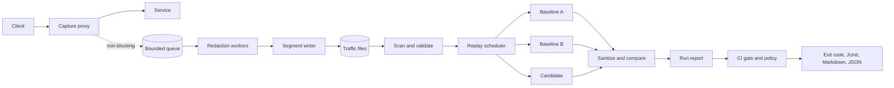

# Architecture

It runs as a local process or as a sidecar from the Helm chart. See [deployment](deployment.md).

## Capture

The client path does as little as possible. It copies bytes passing through into
budgeted memory, and after the response finishes it makes one non-blocking queue send.
A full queue drops the recording, not the request.

| Bound | Default | When exceeded |
|---|---|---|
| Request or response body | 1 MiB | Forwarded in full, body omitted from the record |
| Memory across all bodies | 256 MiB | Forwarded in full, body omitted from the record |
| Queue | 1024 exchanges | Recording dropped, `queue_full` counted |
| Decompressed body | 8 MiB | Body omitted from the record |
| Encoded record | 16 MiB | Recording dropped, `record_too_large` counted |
| Time from finished to written | 5s | Recording dropped, `deadline_exceeded` counted |

Each drop reason has its own counter. Totals are printed when capture stops and stored
in the final segment, so a replay can report the gap.

| Storage failure | Effect |
|---|---|
| Disk full | Recording dropped, `disk_full` counted, partial frame removed, retried after an interval |
| Other write error | Same, counted as `write_error` |
| Slow or stuck writes | Queue fills, then `queue_full`. Clients are unaffected. |

Capture adds some processing overhead to the request path, which hasn't been measured
yet. Benchmarks are planned.

### Shutdown

1. The HTTP server stops accepting and waits for live requests, up to a deadline.
2. Capture waits for any request it is still serving, up to a deadline. This matters
   because an HTTP/2 server can finish shutting down while the handler for a stream the
   client reset is still running.
3. Recording stops accepting, and workers drain the queue, up to a deadline.
4. The final segment is sealed with its record count and drop totals.

If a write is stuck in the OS when the deadline passes, `Close` returns and the process
exits non-zero. A goroutine blocked in that write can't be interrupted, and it exits
when the write returns.

## Documents

- [Traffic format](traffic-format.md)
- [Redaction](redaction.md)
- [Replay](replay.md)
- [Protocols](protocols.md)
- [Deployment](deployment.md)
- [Observability](observability.md)
- [Comparison](diffing.md)
- [CI gate](ci.md)
- [Fixtures](fixtures.md)
- [Related tools](related-tools.md)
- [Decision records](adr/)
